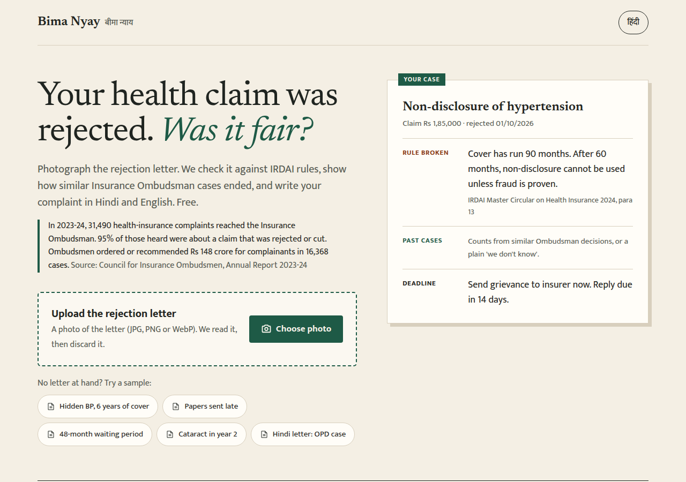
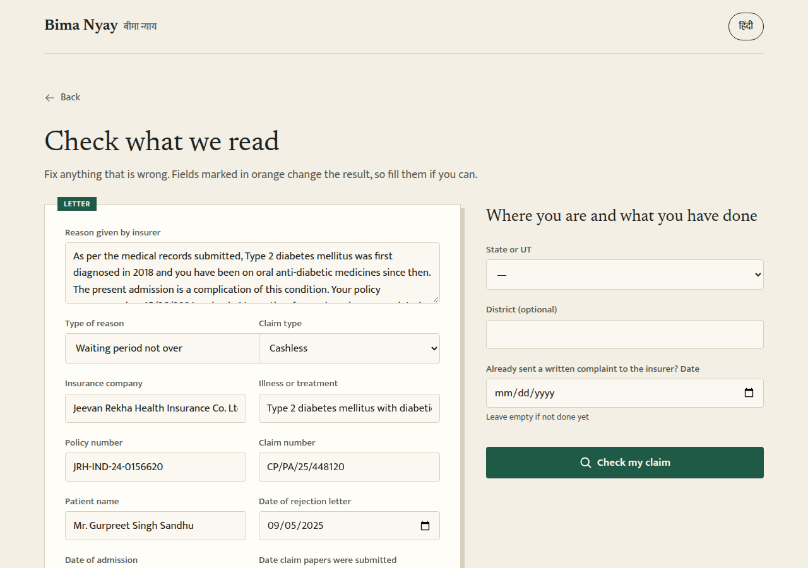
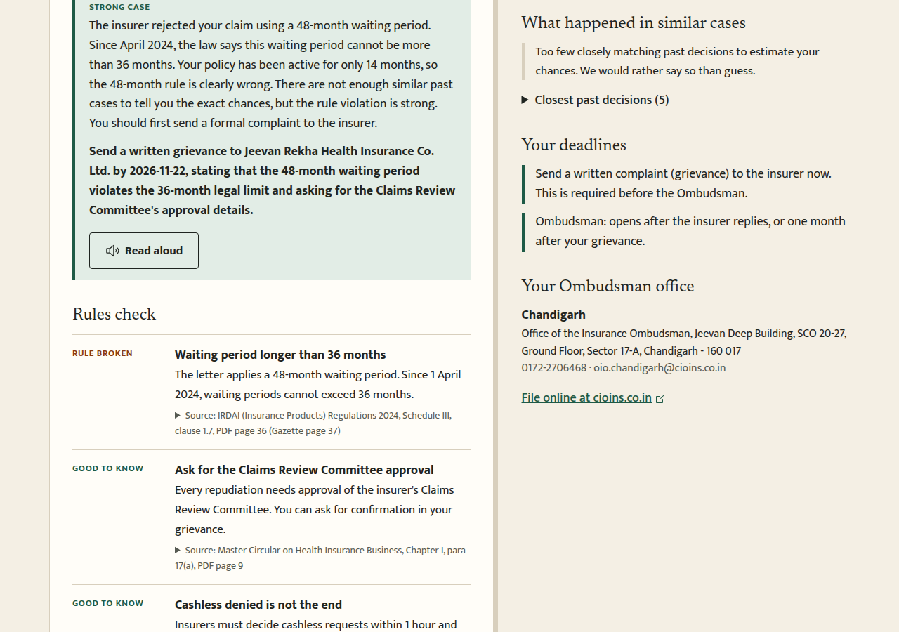
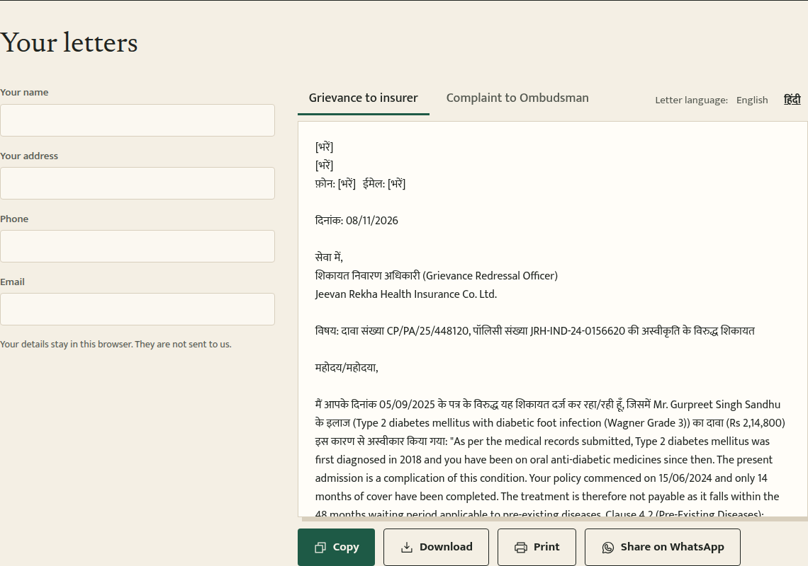
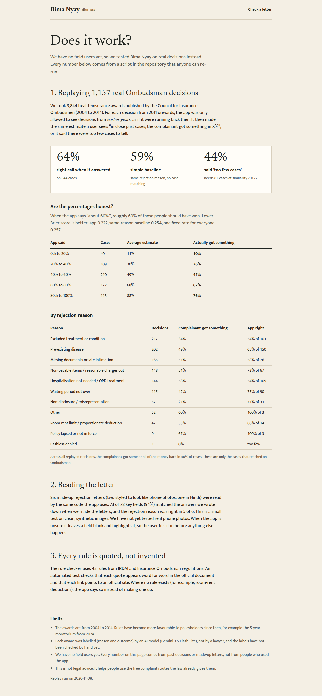

# Bima Nyay (बीमा न्याय)

Live: https://bima-nyay.vercel.app  |  Evidence: https://bima-nyay.vercel.app/evidence  |  Demo video: https://drive.google.com/file/d/1ZADGgkTFej7j1QytafEsmxCSU9BO4DZ8/view

A family's health-insurance claim is rejected or cut. They get a letter they often cannot judge. Bima Nyay reads a photo of that letter and tells them, in Hindi or English:

- whether the stated reason is allowed under current IRDAI rules, with the rule quoted and linked to the official source;
- how similar past Insurance Ombudsman cases ended, or "too few similar cases" when the evidence is thin;
- the deadlines for the insurer grievance and the Ombudsman complaint, and which Ombudsman office covers their state;
- a grievance letter to the insurer and an Ombudsman complaint they can copy, print or share.

How big is it: in 2023-24, 31,490 health-insurance complaints reached the Insurance Ombudsman, and 95% of those heard were about rejected or cut claims. Ombudsmen ordered or recommended about Rs 148 crore (14,792.79 lakh) for complainants in 16,368 cases. Source: Council for Insurance Ombudsmen annual report 2023-24, quoted in `sources/ombudsman-annual-reports.md`. These count only people who got as far as an Ombudsman.

It gives information, not legal advice. It never files anything for the user and never promises an outcome.

Built for the Code for a Billion hackathon, Financial Inclusion track.

| Upload | Check what was read | Result |
|---|---|---|
|  |  |  |

| Hindi grievance letter | Evidence |
|---|---|
|  |  |

## How it works

1. **Read.** A vision model (Qwen 3.8 27B on Cloudflare Workers AI) reads the letter image into a fixed set of fields. The user checks and corrects them.
2. **Agent.** The same model decides which tools to call. Every fact it states comes from a tool:
   - `check_rules`: plain TypeScript, every rule cited (`src/lib/rules`)
   - `find_similar_cases`: vector search over past Ombudsman awards in Neon Postgres (`src/lib/cases`)
   - `compute_deadlines` and `find_ombudsman_office`: plain TypeScript (`src/lib/deadlines`, `src/lib/ombudsman`)
3. **Documents.** The letters are built from templates in code, not written freely by the model (`src/lib/letters`).

The steps the agent takes are shown on screen as they happen. If fewer than 8 similar cases are found, or they are not similar enough, the app says so instead of giving odds.

## Evidence

We have no field users yet. What we have instead is on `/evidence`, and every number comes from a script in this repo:

- **Replay.** Each award from 2011 on is looked up using only awards from earlier years. The search text for stored cases has the decision sentences removed (`src/lib/cases/neutral.ts`), so a case cannot be found through its own outcome. Results are compared with simple baselines. Script: `scripts/replay.mts`, output: `data/processed/replay.json`.
  Run on 8 Nov 2026: 1,157 awards from 2011 to 2014 were replayed against 2,687 earlier ones. The app gave an estimate for 644 and said "too few similar cases" for 513. When it answered, it called the outcome right 64% of the time, against 59% for the same-reason base rate and 50% for always guessing the most common outcome. Brier score 0.222, against 0.254 (base rate) and 0.257 (constant guess); lower is better. High estimates are too confident: cases put at 80-100% were won 76% of the time.
- **Letter reading.** Six made-up letters with known answers. Script: `scripts/eval-extract.mts`.
- **Rules.** A test checks that each rule quote appears word for word in the saved official text in `sources/`.
- **Model choice.** `scripts/bench-models.mts` compares Cloudflare models on letter reading and on the tool loop.

## Limits

- The 4,543 health awards are from 2004 to 2014. Rules have changed since, so past outcomes are context, not a forecast.
- Award labels (reason, outcome, summary) were written by an AI model and have not been checked by hand yet.
- Letter reading was tested on six clean, made-up letters, not on real phone photos.
- Images must be JPG, PNG or WebP. PDFs are not supported.
- The Hindi text has not been reviewed by a native reader.
- Nobody has used the app on a real rejection yet.

## Privacy

The letter image is sent to Cloudflare Workers AI to be read and is not stored by this app. Cloudflare's model page lists zero data retention for the model. The agent receives the extracted facts without names or policy numbers. The only thing we store is an anonymous counter (event, language, reason, day) for `/stats`. There is no login.

## Stack

Next.js (App Router, TypeScript), Tailwind, Neon Postgres with pgvector, Cloudflare Workers AI (`@cf/qwen/qwen3.8-27b` for chat and vision, `@cf/baai/bge-m3` for embeddings), Vercel, Vitest.

## Run it

```bash
pnpm install
cp .env.example .env.local   # fill in the four values below
node --import tsx scripts/db-migrate.mts
pnpm dev
```

| Variable | What it is |
|---|---|
| `CLOUDFLARE_ACCOUNT_ID` | Cloudflare account ID |
| `CLOUDFLARE_API_TOKEN` | API token with the Workers AI permission |
| `DATABASE_URL` | Neon pooled connection string |
| `DATABASE_URL_UNPOOLED` | Neon direct connection string, used by scripts |

Workers AI has a free allowance of 10,000 Neurons a day. One full session (read a letter, run the agent) uses roughly 450 by our estimate, so a busy day needs the paid Workers plan.

### Build the case database yourself

```bash
bash scripts/download-corpus.sh                 # Ombudsman award books (public PDFs)
node --import tsx scripts/ingest-gic.ts         # split books into awards
GEMINI_API_KEY=... node --import tsx scripts/label.mts   # one-off labelling (done already; labels are committed)
node --import tsx scripts/load-cases.mts        # embed and load into Neon
node --import tsx scripts/replay.mts            # rebuild the evidence numbers
```

### Tests

```bash
pnpm test
pnpm exec tsc --noEmit
```

## Sources

Rule texts are saved in `sources/` with the official link for each. The Ombudsman award books come from the Council for Insurance Ombudsmen (cioins.co.in).

## Contributing

Issues and pull requests are welcome. The most useful help: a native Hindi reader to review the letters, real (anonymised) rejection letters for testing, and hand-checking of award labels.

## License

MIT
